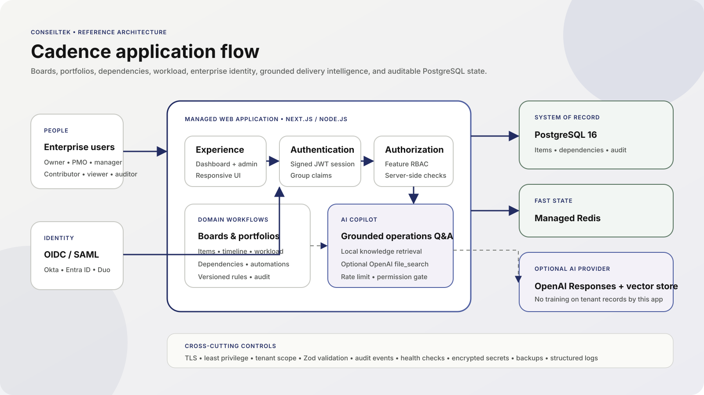

<p align="center"></p>
<h1 align="center">Cadence</h1>
<p align="center"><strong>Work management your PMO actually owns.</strong></p>

[](https://github.com/ConseilTek-Tektons/cadence/actions/workflows/ci.yml) [](https://github.com/ConseilTek-Tektons/cadence/actions/workflows/codeql.yml) [](LICENSE)

Cadence is a deployable work-management reference application for boards, portfolios, dependencies, workload, custom fields, automations, forms, updates, and time tracking. Wider-business viewers can read and comment without a per-seat licensing boundary. See the [product rationale and honest parity matrix](https://conseiltek.com/techtons/cadence).



## Working scope

- PostgreSQL-backed boards, items, parent/child work, dependencies, owners, estimates, dates, custom values, automations, runs, and audit events
- Server-authorized `/api/items` read/create workflow with Zod validation
- Configurable feature RBAC for owners, administrators, portfolio managers, project managers, contributors, viewers, and auditors
- Enterprise OIDC for Okta, Microsoft Entra ID, and Duo; SAML through the included Keycloak broker pattern
- Grounded portfolio Q&A with local retrieval and optional OpenAI `file_search`; no agent or mutation layer
- Responsive ConseilTek interface aligned with the current website design

## Run locally

```bash
cp .env.example .env.local
docker compose up -d postgres redis keycloak
pnpm install --frozen-lockfile
pnpm db:migrate && pnpm db:seed
pnpm dev
```

Open `http://localhost:3000`. Demo personas are available only when `DEMO_AUTH_ENABLED=true`.

## Deploy

One repository contains both supported cloud paths:

- `infra/aws`: AWS App Runner, Aurora PostgreSQL Serverless v2, ElastiCache Serverless, S3, SQS, Secrets Manager, and CloudWatch through Terraform
- `infra/azure`: Azure App Service Web App for Containers, PostgreSQL Flexible Server, Azure Managed Redis, Blob Storage, Storage Queue, Key Vault, and Monitor through Bicep

Cadence requires server-side routes, PostgreSQL transactions, SSO callbacks, and AI orchestration. Static website hosting is not an appropriate runtime.

## Documentation

[Architecture](docs/ARCHITECTURE.md) · [Authentication](docs/AUTHENTICATION.md) · [RBAC](docs/RBAC.md) · [AI](docs/AI.md) · [Security](docs/SECURITY.md) · [Operations](docs/OPERATIONS.md)

Cadence is designed, built, and maintained by [ConseilTek](https://conseiltek.com) under Apache 2.0. Contact [support@conseiltek.com](mailto:support@conseiltek.com).
