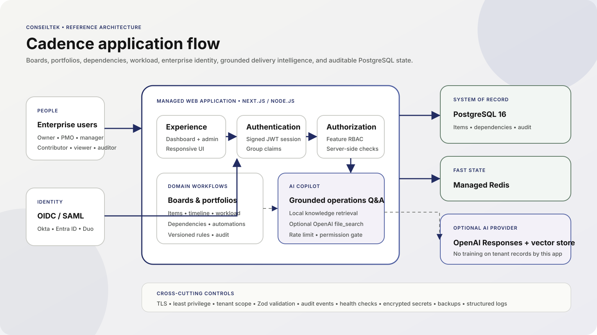
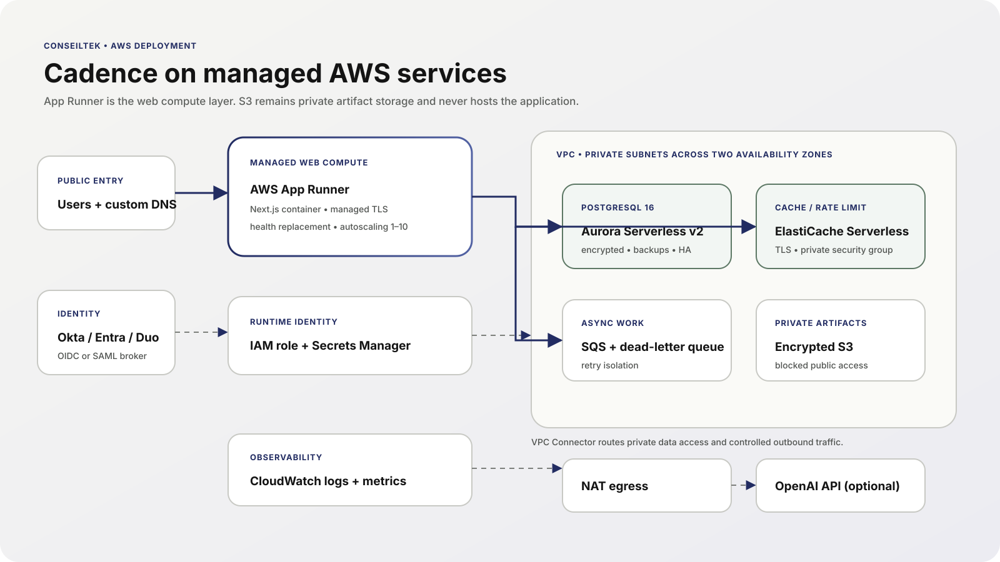
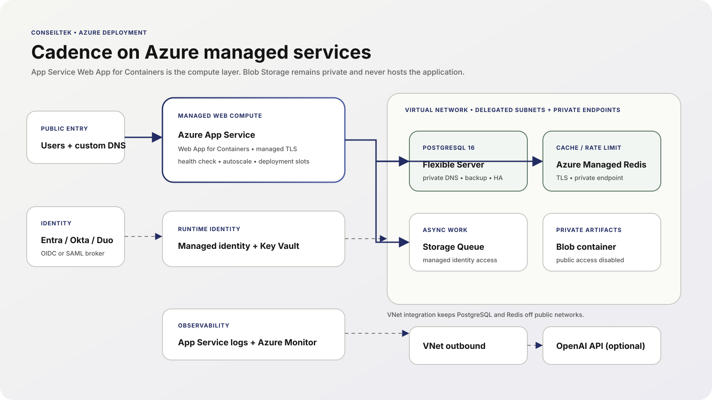

# Cadence architecture

Cadence is a server-rendered Next.js modular application with authenticated APIs, feature authorization, PostgreSQL transactions, optional Redis rate limiting, and grounded AI retrieval. PostgreSQL 16 is authoritative for boards, work items, dependencies, automations, time entries, and audit history.

## Request flow

1. Okta, Entra ID, Duo, or a SAML broker authenticates the user through OIDC.
2. The signed session carries mapped application roles; every protected API rechecks the required feature permission.
3. Zod validates input and parameterized SQL enforces tenant scope.
4. Domain transactions write work and audit events atomically. Dependency and portfolio calculations remain reproducible from source records.
5. AI retrieval receives only permitted context and has no mutation tools.

## Managed deployment

AWS uses App Runner, Aurora PostgreSQL Serverless v2, ElastiCache Serverless, private S3, SQS, Secrets Manager, and CloudWatch. Azure uses App Service Web App for Containers, PostgreSQL Flexible Server, Azure Managed Redis, private Blob Storage, Storage Queue, Key Vault, and Monitor.

Neither deployment uses static website hosting. Managed container compute and managed PostgreSQL reduce operating-system and control-plane maintenance while retaining a portable OCI image.
